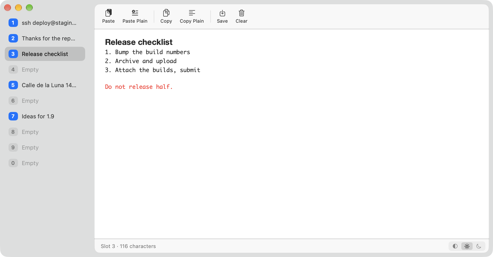
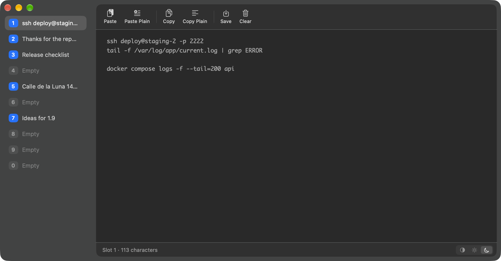

# Simple Note Buffer

Ten slots of text that are still there next week. A place for a piece of text that is not worth a file and must not be lost when the app is closed: a command, an address, a draft of a reply, a list for tomorrow.


| Light | Dark |
|------|------|
|  |  |

## Download

**[Download SimpleNoteBuffer.dmg](https://github.com/lexey111/SimpleNoteBuffer/releases/latest/download/SimpleNoteBuffer-1.0.0.dmg)**

### Install

1. Open the DMG and drag **SimpleNoteBuffer** to **Applications**
2. The app is signed with a Developer ID and notarized by Apple, so it opens like any other
3. **If macOS asks about clipboard access** — since 15.4 it can, depending on settings, before an app reads what other apps copied. The clipboard column never raises that dialog: where the setting is "Ask" it says so and offers a shortcut to **System Settings → Privacy & Security → Paste from Other Apps**. Set **SimpleNoteBuffer** to **Allow** there to see the preview, or hide the column (View ▸ Show Clipboard)


## What it does

- **Ten numbered slots** in a column at the side, ⌘1 … ⌘0. A slot that holds something is lit and shows its first line.
- **A text editor in each**: type, select, copy a fragment, undo, find (⌘F).
- **Paste** keeps styles and pictures; **Paste as Plain Text** (⌥⇧⌘V) takes the words only.
- **Copy** takes the selection, or the whole slot when nothing is selected (⇧⌘C); **Copy as Plain Text** (⌥⇧⌘C) drops the styles.
- **Save to File…** (⌘S): plain text, RTF, or RTFD where the slot holds pictures.
- **Clear Slot** (⇧⌘⌫). Undo brings the text back.
- **Light and dark**: Auto · Day · Night in the status line, and in the View menu.
- **The clipboard beside the page**: a third column shows what is on the clipboard now — the head of the text, the picture, the file names. It looks only while the app is in front, and can be hidden (View ▸ Show Clipboard, ⌥⌘B).
- **Your layout**: drag the gaps beside the page to size the columns; the buttons show their names or icons only (View ▸ Show Button Labels).
- **Nothing to manage**: no names, no folders, no history, no account. Nothing is corrected or replaced as you type.

## How it keeps the text

Each slot is written to its own file in the app's container half a second after it changes, and again when the app is put aside or quit. Closing the window quits the app; the next launch opens on the slot you left.

The app is sandboxed. It reads the clipboard when you paste and, while it is in front, for the preview column; where macOS is set to ask before each read, the column says so instead of asking. Files are written only where the save dialog points.

## Building

Open `SimpleNoteBuffer.xcodeproj` in Xcode 16 or later and run, or:

```bash
./scripts/build-release.sh 1.0.0   # → build/SimpleNoteBuffer-1.0.0.dmg
```

With a Developer ID Application certificate in the keychain the script signs the app and the DMG with it, notarizes the DMG and staples the ticket (credentials from the keychain profile `simple-utilities-notary`, stored once with `xcrun notarytool store-credentials`); without one the build is ad-hoc signed.

`scripts/make-icon.swift` draws the app icon at every size.
